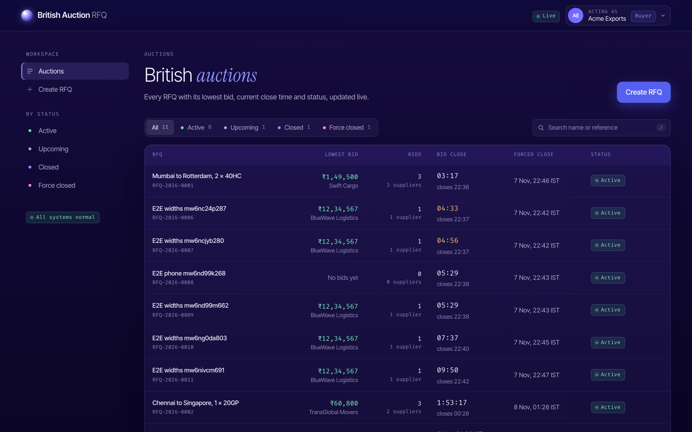
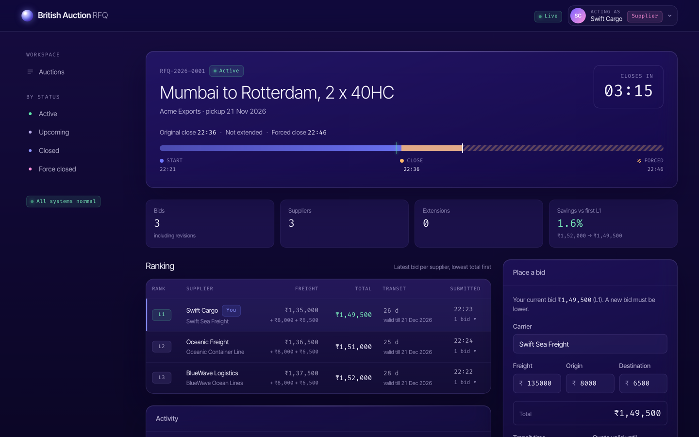
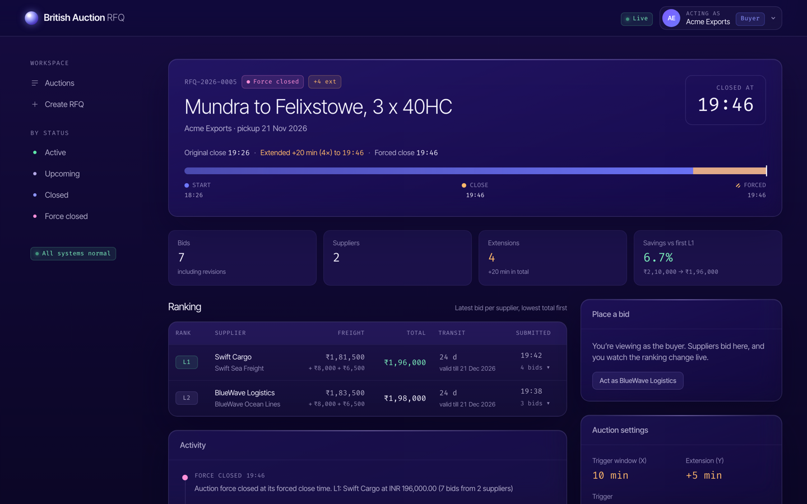
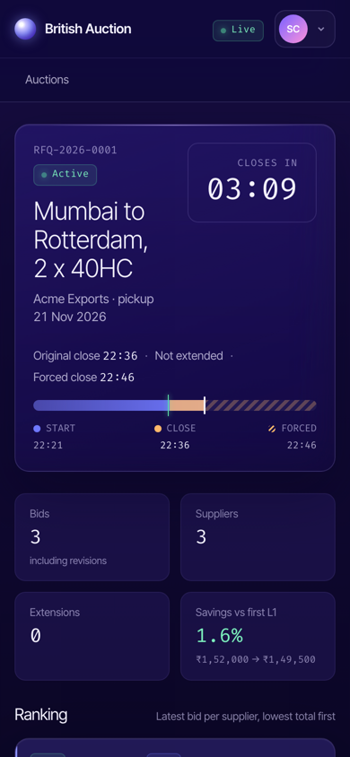

# British Auction RFQ System

An RFQ (Request for Quotation) platform with **British Auction** bidding. Buyers create an RFQ. Suppliers bid openly and keep lowering their prices. When there is activity near the close, the auction is extended automatically, but it never runs past a hard **forced close** time.

**Stack:** FastAPI · PostgreSQL · SQLAlchemy 2 + Alembic · Celery + Redis · WebSockets · React + TypeScript + Vite · Docker Compose



## Quick start

```bash
docker compose up --build
```

Open **http://localhost:8080**. On the first run the database is migrated and seeded with demo users and five auctions covering every status.

To run the app outside Docker for development, see [Local development](#local-development).

## Demo guide

There is no login. Use the **Acting as** menu (top right) to switch user. Each open tab keeps its own user, so two windows can be two different people. A new tab, or a reload, starts as the user picked last.

| User | Role | Try this |
|---|---|---|
| Acme Exports, Nova Retail | Buyer | Create an RFQ, watch the ranking and activity log update live |
| BlueWave Logistics, Swift Cargo, Oceanic Freight, TransGlobal Movers | Supplier | Bid on an active auction, then undercut another supplier |

A suggested walkthrough:

1. As **Acme Exports**, click **Create RFQ**. The preview shows the trigger window and the forced-close cap on a timeline as you type. Pick a start a minute away, a close 5 minutes later and a forced close 10 minutes later, with X = 5 minutes and Y = 2 minutes.
2. Open the new auction in a second window and switch it to **Swift Cargo**. The page shows a countdown to the start, and the bid form opens by itself when the auction starts.
3. Place a bid. Because it falls inside the window, the close moves out by Y, and both windows update without reloading. The activity log records why it was extended.
4. Switch the first window to **BlueWave Logistics** and undercut. Swift Cargo is told they were outbid.
5. Keep bidding until the extensions reach the forced close. A further trigger is logged as "no extension", and the auction is **force closed** on time.

Or let bots do it:

```bash
docker compose exec api python -m scripts.simulate_bidding --web http://localhost:8080
# outside Docker: make simulate
```

The simulator creates a 3-minute auction and has bot suppliers fight over it. It prints each bid and extension, then the cap and the force close. You can watch it in the browser while it runs.

| Auction details as a supplier | Force-closed auction | Phone |
|---|---|---|
|  |  |  |

## Features

| | Requirement | Where |
|---|---|---|
| R1–R3 | Create an RFQ with British Auction settings: name, reference ID, bid start, bid close, forced close, pickup date, trigger window X, extension Y, trigger type | `POST /api/rfqs`, Create RFQ page with a live schedule preview |
| R4 | Quotes with carrier, freight, origin and destination charges, transit time and quote validity | `POST /api/rfqs/{id}/bids`, bid form |
| R5, R6 | The forced close must be after the bid close, and extensions never pass the forced close | Request validation, the auction engine and database CHECK constraints |
| R7–R9 | Extension triggers: any bid, any rank change, or a change of L1, within the last X minutes | `app/domain/auction_engine.py` |
| R10, R11 | Suppliers can only lower their own price. No bid is accepted after the close or the forced close | Checked under a row lock, using server time |
| R12, R13 | Listing with the lowest bid, current close, forced close and status (Upcoming, Active, Closed, Force closed) | Listing page, with filters, search and live updates |
| R14–R16 | Details: ranking L1, L2, …, the quote breakdown, and the X, Y and trigger settings | Details page |
| R17 | Activity log: every bid and extension, with the reason for each extension | Details page, paginated |
| R18 | Live progress: countdowns corrected to server time, and updates within about 100 ms over WebSockets | Redis pub/sub → `/ws` |

Auctions start and close at their exact times through scheduled Celery jobs. A Celery Beat sweep every 5 seconds catches any job that was missed.

## Design documents

- [High-level design](docs/HLD.md): architecture, auction rules, key flows, concurrency, real-time updates, **assumptions**, limitations
- [Database schema](docs/SCHEMA.md): ER diagram, tables, constraints, indexes, DDL
- [API reference](docs/API.md): REST endpoints, error codes, WebSocket events (live Swagger UI at `/docs` when the API runs locally)
- [Testing](docs/TESTING.md): test suites, the bugs they found, and which test covers each scenario

Diagrams are also exported as PNG in [docs/diagrams](docs/diagrams).

### Key assumptions

The full list, with reasons, is in [HLD §8](docs/HLD.md#8-assumptions).

- The bid total is freight + origin + destination charges.
- Only each supplier's latest bid is ranked, and a revision must be lower than their previous bid.
- Ties go to the earlier bid.
- The trigger window is `[current close − X, current close)`. An extension is added to the current close, capped at the forced close.
- A "rank change" means an already-ranked supplier's rank changed. An "L1 change" includes the first bid of the auction.
- **Force closed** means the auction ended at its forced close time. An auction that ends earlier is **Closed**.

## Local development

Prerequisites: Python 3.12+, Node.js 22+ and Docker.

```bash
make setup     # venv, backend + frontend dependencies, backend/.env
make up        # Postgres + Redis only, in Docker
make migrate   # create the tables
make seed      # demo users and auctions (make seed args=--reset to start over)
```

Then run each of these in its own terminal:

```bash
make api       # FastAPI on http://localhost:8000 (Swagger UI: /docs)
make worker    # Celery worker: opens and closes auctions at their exact times
make beat      # Celery Beat: the 5-second safety-net sweep
make web       # React app on http://localhost:5173
```

`make help` lists every command.

## Tests

```bash
make check     # lint, types, backend tests (pytest) and frontend tests (Vitest), then the build
make e2e       # Playwright browser tests against the running stack
make simulate  # bot suppliers fight over a short auction until it force-closes
```

The suites:

- **Backend:** 246 pytest tests with 98% coverage, including a model-based test that checks random auctions against an independent model of the rules, API fuzzing, and a 20-way concurrency test.
- **Frontend:** 177 Vitest tests with 97% coverage.
- **Browser:** 8 Playwright tests, run against the full stack in CI. They include accessibility checks with axe.

See [docs/TESTING.md](docs/TESTING.md) for the details.

## Repository layout

```
backend/
  app/domain/      auction engine: pure functions for ranking, triggers, extension and status
  app/services/    use cases: create RFQ, submit bid, lifecycle, queries (own the transactions)
  app/api/         FastAPI routers, dependencies, WebSocket endpoint
  app/workers/     Celery app, start/close tasks, sweeper
  app/realtime/    Redis pub/sub relay and connection manager
  alembic/         migrations
  scripts/         seed and simulate_bidding
  tests/           unit and integration tests (real Postgres and Redis)
frontend/
  src/features/    listing, create RFQ, auction details, bid form
  src/realtime/    shared WebSocket client (reconnects, resubscribes, resyncs)
  e2e/             Playwright tests
docs/              HLD, schema, API, testing, diagrams, screenshots
```

## Future improvements

- Real authentication (OAuth2/JWT) and per-organisation access, instead of the `X-User-Id` header
- Inviting specific suppliers to an RFQ
- RabbitMQ, or a persistent scheduler, so close jobs survive a broker restart without relying on the sweep
- A metrics page for the business goals: price improvement and participation in extended vs. non-extended auctions
