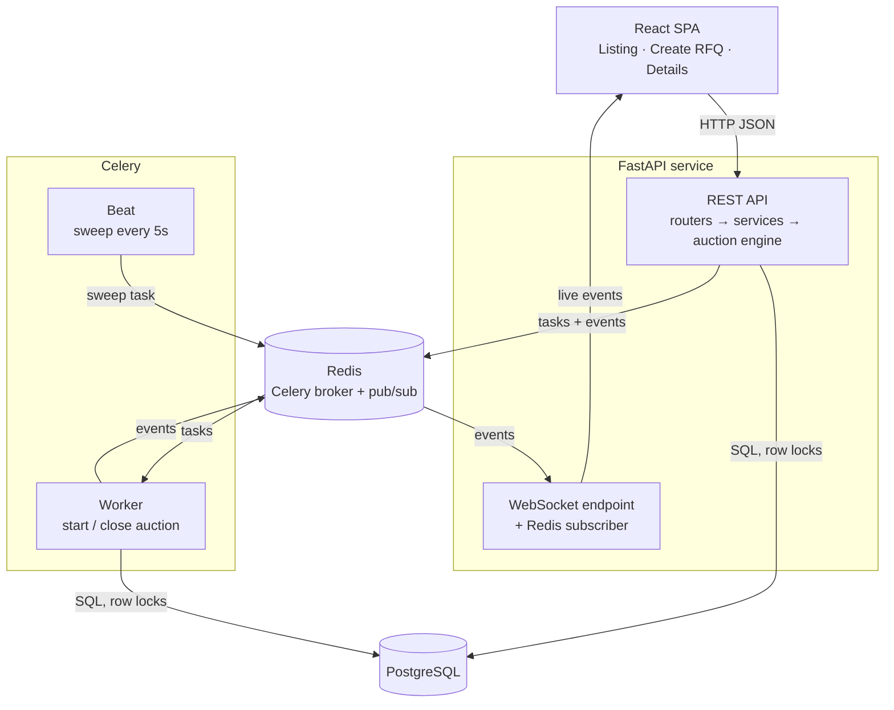
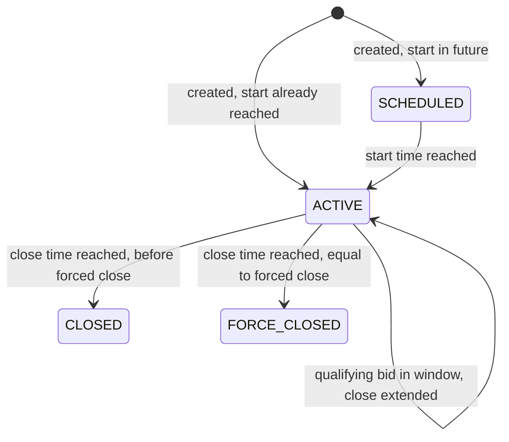
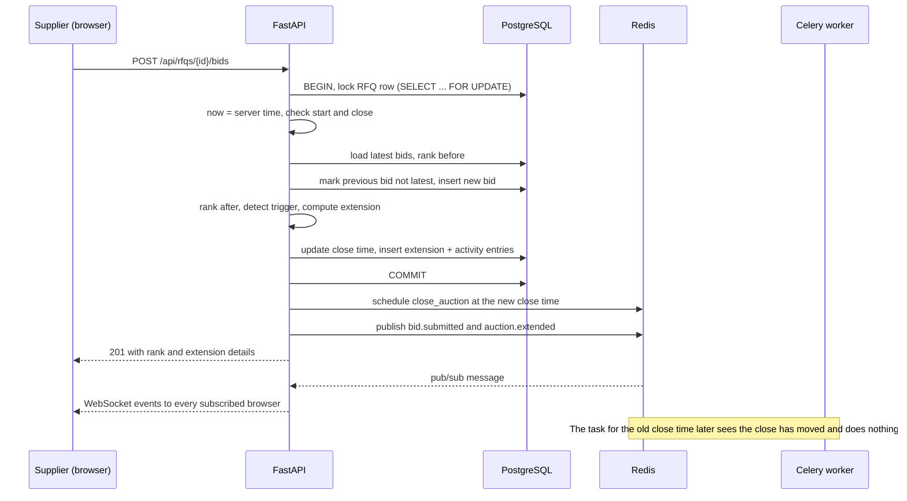

# High-Level Design — British Auction RFQ System

Related: [Database schema](SCHEMA.md) · [API reference](API.md)

## 1. Overview

Buyers create an RFQ (Request for Quotation) and suppliers compete for it in a **British (reverse) auction**: bids are open, suppliers keep lowering their price, and the lowest price wins.

Two time rules make the auction fair:

- **Automatic extension.** If qualifying activity happens in the last **X** minutes before the close, the close moves out by **Y** minutes. This removes the advantage of a last-second bid.
- **Forced close.** A hard deadline set at creation. Extensions never move the close past it, and no bid is accepted after it.

What "qualifying activity" means is chosen per auction: *any bid*, *any change in supplier ranking*, or *a change of the lowest bidder (L1)*.

### Goals

| Goal | How the design supports it |
|---|---|
| Transparent, fair competition | Live ranking (L1, L2, …) and an activity log that records every bid and every extension with its reason |
| Prevent last-minute manipulation | Extension rules applied on the server, using server time, inside a database transaction |
| Encourage participation | Real-time updates and a visible countdown; extensions give competitors time to respond |
| Better final prices | The auction keeps running while suppliers are still undercutting each other, up to the forced close |

---

## 2. Architecture



| Component | Responsibility |
|---|---|
| **React SPA** | Listing, RFQ creation and auction detail pages. Holds one WebSocket connection and patches its cached data when events arrive. |
| **REST routers (FastAPI)** | HTTP only: validate input with Pydantic, resolve the acting user, call a service, return JSON. |
| **Services** | Use cases (create RFQ, submit bid, start/close auction). Own the database transaction, call the engine, write the activity log, then schedule tasks and publish events **after commit**. |
| **Auction engine** | Pure functions: ranking, trigger-window check, trigger detection, extension calculation, status derivation. No database, no clock — time is passed in. |
| **PostgreSQL** | System of record. Constraints enforce the core invariants (forced close > bid close; current close never past forced close; one active bid per supplier). |
| **Celery worker** | `start_auction` and `close_auction` tasks, scheduled to run at the exact start and close times. |
| **Celery Beat** | `sweep_auctions` every 5 s: applies any start or close that a task missed. |
| **Redis** | Celery broker, plus a pub/sub channel used by the API and the workers to publish live events. |
| **WebSocket endpoint + pub/sub listener** | Each API process subscribes to Redis and forwards events to the browsers subscribed to that auction or to the listing. |

---

## 3. Auction rules

### 3.1 Configuration (per RFQ)

| Setting | Meaning | Example |
|---|---|---|
| Trigger window **X** (minutes) | How close to the *current* close activity is watched | Close 18:00, X = 10 → watch 17:50–18:00 |
| Extension **Y** (minutes) | How much a qualifying event adds to the close | 18:00 → 18:05 |
| Trigger type | `BID_RECEIVED`, `ANY_RANK_CHANGE` or `L1_CHANGE` | see 3.3 |

### 3.2 Bids and ranking

- Bid total = freight + origin + destination charges. Suppliers are ranked by total, lowest first (L1, L2, …).
- A supplier can revise their bid, but each new bid must be **strictly lower** than their own previous one. Only a supplier's latest bid is ranked; older bids stay in history.
- Equal totals: the bid submitted first ranks higher.
- A bid is accepted only while `bid_start_at ≤ now < current_close_at`, using **server time**.

### 3.3 Extension triggers

A bid can extend the auction only if it arrives inside the window `[current_close − X, current_close)`. Whether it does then depends on the trigger type:

| Trigger type | Extends when the bid… |
|---|---|
| `BID_RECEIVED` | is accepted (any bid) |
| `ANY_RANK_CHANGE` | changes the rank of at least one supplier who was already ranked |
| `L1_CHANGE` | changes which supplier is L1 (including the first bid of the auction) |

### 3.4 Extension

```
new_close = min(current_close + Y, forced_close)
```

- If the extension is cut short by the forced close, it is logged as **capped**.
- If the close is already at the forced close, the trigger is logged as **skipped** and nothing changes.
- The window always follows the current close, so extensions can chain until the forced close is reached.

### 3.5 Status



| Status | Meaning |
|---|---|
| `SCHEDULED` (shown as "Upcoming") | Bidding has not started |
| `ACTIVE` | Bids are accepted |
| `CLOSED` | Ended at its close time, before reaching the forced close |
| `FORCE_CLOSED` | Ended because extensions pushed it to the forced close and it was stopped there |

### 3.6 Worked example

Close 18:00, forced close 18:20, X = 10, Y = 5, trigger = `L1_CHANGE`.

| Time | Event | Outcome | Close after |
|---|---|---|---|
| 17:40 | A bids 100 | Outside window | 18:00 |
| 17:52 | B bids 95 | In window, L1 A → B: **extend** | 18:05 |
| 17:58 | B bids 90 | In window, L1 still B: no extension | 18:05 |
| 18:01 | A bids 85 | L1 B → A: **extend** | 18:10 |
| 18:08 | B bids 80 | L1 A → B: **extend** | 18:15 |
| 18:12 | A bids 75 | L1 B → A: **extend** (reaches forced close exactly) | 18:20 |
| 18:16 | B bids 70 | Trigger met, already at forced close: **skipped** | 18:20 |
| 18:20 | Close task runs | Close = forced close → **FORCE_CLOSED**, winner B at 70 | — |
| 18:20:01 | C tries to bid | Rejected: auction closed | — |

---

## 4. Key flows

### 4.1 Submit a bid (with extension)



### 4.2 Create an RFQ

1. Pydantic checks the input, including **forced close > bid close**.
2. In one transaction: insert the RFQ (current close = bid close), its auction configuration, and an `RFQ_CREATED` activity entry.
3. After commit: schedule `start_auction` at the start time and `close_auction` at the close time, then publish `rfq.created` to the listing channel.

### 4.3 Close an auction

`close_auction(rfq_id, expected_close_at)` runs at the scheduled close time:

1. Lock the RFQ row.
2. If the auction is no longer active, or its close time differs from `expected_close_at` (it was extended), do nothing — a later task covers the new time.
3. If the task ran early, it re-queues itself for the close time.
4. Otherwise set the status to `CLOSED` or `FORCE_CLOSED`, record the L1 supplier and amount in the activity log, and publish `auction.status`.

`start_auction` works the same way for the start time. The Beat sweeper runs the same logic for any auction whose start or close time has passed but whose status was not updated. It uses `SKIP LOCKED`, so it never waits behind a bid in progress; the next sweep, 5 s later, picks that auction up.

Start and close entries are dated at the scheduled start or close time, not at the moment the job ran, so the activity log reads correctly even after worker downtime. For the same reason, a bid that arrives before the start job has run opens the auction itself, under the same lock, before it is recorded. A job that is very late applies both transitions in order.

Queuing a job is best effort. If Redis is down when an RFQ is created or extended, the request still succeeds and the sweeper performs the transition.

### Deployment

`docker compose up --build` runs the system as seven containers from two images:
- **postgres** and **redis**;
- **migrate**, a one-shot job that applies migrations and seeds demo data;
- **api** (uvicorn), **worker** (Celery) and **beat** (Celery Beat), all from one backend image;
- **frontend**: nginx serving the built React app on port 8080 and proxying `/api` and `/ws` to the API, so the browser sees a single origin.

The API, worker and Beat start only after the migration job succeeds. The API container has a health check on `/api/health`, which checks the database, Redis and the event relay.

---

## 5. Consistency and concurrency

- **One lock per auction.** Bid submission and closing both start with `SELECT … FOR UPDATE` on the RFQ row, so they run one at a time for that auction. Two bids that arrive together cannot both read the same "before" ranking or both extend from the same close time.
- **Server time is authoritative.** "Now" is read *after* the lock is taken. Client clocks are only used for the countdown display.
- **Closing does not depend on the worker.** A bid is accepted only if `now < current_close_at`, checked under the lock. A late or missing close task delays the "closed" event, but can never let a bid in after the close.
- **Status is also derived on read.** APIs compute the status from the times, so pages are correct even before the worker updates the stored status.
- **Database constraints back up the code.** CHECK constraints (forced close > bid close; bid close ≤ current close ≤ forced close) and a partial unique index (one latest bid per supplier per RFQ) hold even if application code has a bug.
- **Events are published after commit.** Browsers never see a change that was rolled back.
- **Tasks are idempotent.** A close task that runs twice, or runs for an outdated close time, does nothing.

---

## 6. Real-time updates

- The browser opens one WebSocket to `/ws` and subscribes to channels: `listing` on the listing page, `rfq:{id}` on a detail page.
- The API and the workers publish events to Redis. Every API process forwards them to its own subscribed sockets, so this works with several API processes and with events that start in a Celery worker.
- Events: `bid.submitted`, `auction.extended`, `auction.status`, `listing.updated`, `rfq.created`.
- Every response and event includes `server_time`. The browser uses it to correct its clock for the countdown.
- **Events can arrive out of order.** Two bids on the same auction commit one after the other, but each publishes after its own commit, so the second bid's event can be sent first. Every event and every REST snapshot therefore carries a `version`: the id of the auction's newest activity entry. The row lock makes it grow with every change. The browser keeps the highest version it has seen and ignores anything older. Event payloads are read in a separate REPEATABLE READ transaction, so the version and the state it describes always match.
- Each activity entry is sent in exactly one event, so the activity feed can simply append.
- **Missed events.** If Redis restarts, events published meanwhile are lost. When the API reconnects to Redis it sends `resync` to every socket, and the browser reloads over REST. The browser does the same after its own reconnect. A page opened fresh subscribes first and then loads over REST, so nothing falls in between.
- Publishing never fails a request: the change is already committed, and a publishing error is only logged.

---

## 7. Technology choices

| Area | Choice | Reason |
|---|---|---|
| API | Python 3.12, FastAPI, Pydantic v2 | Typed request/response models, dependency injection, generated OpenAPI docs |
| Database | PostgreSQL 16 | Transactions, row locks, CHECK constraints, partial indexes |
| Data access | SQLAlchemy 2 (sync) + Alembic | One set of models and sessions shared by the API and the Celery workers |
| Background jobs | Celery + Redis, Celery Beat | Exact-time start/close tasks, with a periodic sweep as a safety net |
| Real-time | FastAPI WebSockets + Redis pub/sub | No extra service; works across processes |
| Frontend | React, TypeScript, Vite | Typed components; TypeScript types generated from the API's OpenAPI schema |
| Tooling | Docker Compose, GitHub Actions, pytest, ruff, mypy | Reproducible setup and automated checks |

---

## 8. Assumptions

The assignment leaves these points open; the choices below are deliberate.

1. **Users and roles.** Users are seeded. A user is either a **buyer** (creates RFQs) or a **supplier** (bids). The acting user is sent in an `X-User-Id` header; there is no login.
2. **Bid total** is freight + origin + destination charges, in one currency (INR).
3. **Revisions.** Each new bid from a supplier must be lower than their previous one. Only the latest bid is ranked.
4. **Ties** go to the bid submitted first.
5. **Trigger window** is measured from the *current* close time, includes its start and excludes the close itself.
6. **Extensions** are added to the current close time, not to the time of the bid.
7. **Rank change** means a supplier who was already ranked now has a different rank. A new supplier entering in last place changes no one's rank.
8. **L1 change** includes the first bid of the auction (from no L1 to an L1). The current L1 lowering their own price is not an L1 change.
9. **Force Closed** means the auction ended at its forced close time because extensions reached it. An auction that ends before the forced close is **Closed**.
10. **Upcoming status.** Auctions that have not started are shown as "Upcoming" (`SCHEDULED`), a status the assignment does not list.
11. **No edits.** An RFQ cannot be edited after creation, so the rules cannot change during an auction.
12. **Quote validity** must cover the pickup date.
13. **Open bidding.** All suppliers see all bids and ranks, as in an open British auction.

## 9. Limitations and future work

- **Broker outages delay closes slightly.** When the worker loses its connection to Redis, Celery drops the scheduled jobs it is holding. The 5-second sweep then performs the close, so it can come up to about 5 s late (seen in testing after a Redis restart). Bids are never affected: a bid is accepted by time alone, under the lock. RabbitMQ, or a scheduler that persists jobs, would remove the delay.

- **Authentication:** replace the `X-User-Id` header with real login (OAuth2/JWT) and per-organisation access.
- **Supplier invitations:** today every supplier can bid on every RFQ.
- **Broker:** RabbitMQ instead of Redis for stronger delivery guarantees on long-delayed tasks (the sweeper covers this today).
- **Scale:** more API replicas (already supported through pub/sub), read replicas for the listing, time-based partitioning of the activity log.
- **Metrics page** for the success metrics: bids per RFQ and price improvement in extended vs. non-extended auctions. The schema already stores what this needs.
- **Graph data (Neo4j)** could model supplier–lane–buyer relationships for supplier recommendations; the auction itself has no graph-shaped data.
