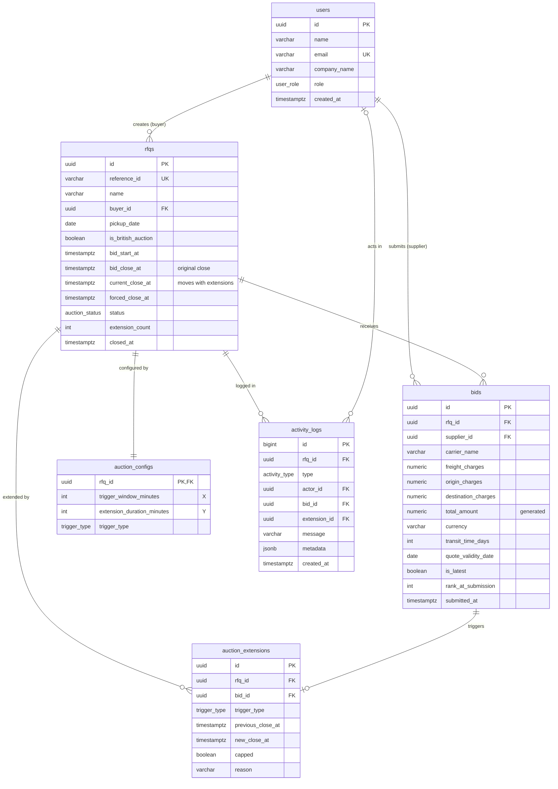

# Database Schema — British Auction RFQ System

PostgreSQL 16. All timestamps are `TIMESTAMPTZ` stored in UTC; money is `NUMERIC(14,2)`. Primary keys are UUIDs (`gen_random_uuid()`), except the activity log, which uses a sequence for strict ordering. Migrations are managed with Alembic.

## 1. Entity-relationship diagram



## 2. Enum types

| Type | Values |
|---|---|
| `user_role` | `BUYER`, `SUPPLIER` |
| `auction_status` | `SCHEDULED`, `ACTIVE`, `CLOSED`, `FORCE_CLOSED` |
| `trigger_type` | `BID_RECEIVED`, `ANY_RANK_CHANGE`, `L1_CHANGE` |
| `activity_type` | `RFQ_CREATED`, `AUCTION_STARTED`, `BID_SUBMITTED`, `AUCTION_EXTENDED`, `EXTENSION_SKIPPED`, `AUCTION_CLOSED`, `AUCTION_FORCE_CLOSED` |

## 3. Tables

### 3.1 `users`
Seeded buyers and suppliers.

| Column | Type | Constraints | Purpose |
|---|---|---|---|
| `id` | UUID | PK | |
| `name` | VARCHAR(100) | NOT NULL | Contact name |
| `email` | VARCHAR(160) | NOT NULL, UNIQUE | |
| `company_name` | VARCHAR(160) | NOT NULL | Shown in rankings and the activity log |
| `role` | `user_role` | NOT NULL | Buyers create RFQs; suppliers bid |
| `created_at` | TIMESTAMPTZ | NOT NULL, default `now()` | |

### 3.2 `rfqs`
One row per RFQ / auction. This row is also the **lock** that serialises bids and closing for an auction.

| Column | Type | Constraints | Purpose |
|---|---|---|---|
| `id` | UUID | PK | |
| `reference_id` | VARCHAR(30) | NOT NULL, UNIQUE | Human-readable ID, e.g. `RFQ-2026-0001`; the number comes from `rfq_reference_seq` |
| `name` | VARCHAR(120) | NOT NULL | RFQ name |
| `buyer_id` | UUID | FK → `users.id`, NOT NULL | Creator |
| `pickup_date` | DATE | NOT NULL | Pickup / service date |
| `is_british_auction` | BOOLEAN | NOT NULL, default `true` | Kept so non-auction RFQs can be added later |
| `bid_start_at` | TIMESTAMPTZ | NOT NULL | Bidding opens |
| `bid_close_at` | TIMESTAMPTZ | NOT NULL | **Original** close; never changed |
| `current_close_at` | TIMESTAMPTZ | NOT NULL | Live close; moved by extensions |
| `forced_close_at` | TIMESTAMPTZ | NOT NULL | Hard deadline |
| `status` | `auction_status` | NOT NULL, default `SCHEDULED` | Stored by the lifecycle tasks; APIs also derive it from the times |
| `extension_count` | INT | NOT NULL, default 0, ≥ 0 | Shown on listing and detail pages |
| `closed_at` | TIMESTAMPTZ | NULL | When bidding ended |
| `created_at`, `updated_at` | TIMESTAMPTZ | NOT NULL | |

Check constraints:

| Name | Rule | Requirement |
|---|---|---|
| `chk_close_after_start` | `bid_close_at > bid_start_at` | Sensible schedule |
| `chk_forced_after_close` | `forced_close_at > bid_close_at` | "Forced close must be greater than bid close" |
| `chk_current_in_bounds` | `bid_close_at <= current_close_at <= forced_close_at` | "Extensions must never exceed forced close" |

### 3.3 `auction_configs`
British auction settings, one row per RFQ.

| Column | Type | Constraints | Purpose |
|---|---|---|---|
| `rfq_id` | UUID | PK, FK → `rfqs.id` ON DELETE CASCADE | |
| `trigger_window_minutes` | INT | NOT NULL, 1–120 | **X** |
| `extension_duration_minutes` | INT | NOT NULL, 1–120 | **Y** |
| `trigger_type` | `trigger_type` | NOT NULL | What activity extends the auction |

### 3.4 `bids`
Every quote a supplier submits, including superseded revisions.

| Column | Type | Constraints | Purpose |
|---|---|---|---|
| `id` | UUID | PK | |
| `rfq_id` | UUID | FK → `rfqs.id` ON DELETE CASCADE, NOT NULL | |
| `supplier_id` | UUID | FK → `users.id`, NOT NULL | |
| `carrier_name` | VARCHAR(100) | NOT NULL | |
| `freight_charges` | NUMERIC(14,2) | NOT NULL, ≥ 0 | |
| `origin_charges` | NUMERIC(14,2) | NOT NULL, ≥ 0 | |
| `destination_charges` | NUMERIC(14,2) | NOT NULL, ≥ 0 | |
| `total_amount` | NUMERIC(14,2) | **generated**: sum of the three charges | Ranking key; cannot drift from its parts |
| `currency` | VARCHAR(3) | NOT NULL, default `INR` | |
| `transit_time_days` | INT | NOT NULL, 1–365 | |
| `quote_validity_date` | DATE | NOT NULL | Quote valid until |
| `notes` | VARCHAR(500) | NULL | |
| `is_latest` | BOOLEAN | NOT NULL, default `true` | Only the latest bid per supplier is ranked |
| `rank_at_submission` | INT | NULL | Supplier's rank right after this bid (history) |
| `submitted_at` | TIMESTAMPTZ | NOT NULL | Server time, after the auction lock was taken; tie-breaker |

### 3.5 `auction_extensions`
One row per applied extension. Structured data for reporting; the activity log holds the readable timeline.

| Column | Type | Constraints | Purpose |
|---|---|---|---|
| `id` | UUID | PK | |
| `rfq_id` | UUID | FK → `rfqs.id` ON DELETE CASCADE, NOT NULL | |
| `bid_id` | UUID | FK → `bids.id`, NOT NULL | Bid that caused it |
| `trigger_type` | `trigger_type` | NOT NULL | Rule in force |
| `previous_close_at` | TIMESTAMPTZ | NOT NULL | |
| `new_close_at` | TIMESTAMPTZ | NOT NULL, `> previous_close_at` | |
| `capped` | BOOLEAN | NOT NULL, default `false` | True when shortened by the forced close |
| `reason` | VARCHAR(300) | NOT NULL | e.g. "New L1: Swift Cargo replaced BlueWave Logistics" |
| `created_at` | TIMESTAMPTZ | NOT NULL | |

### 3.6 `activity_logs`
Timeline shown on the auction detail page.

| Column | Type | Constraints | Purpose |
|---|---|---|---|
| `id` | BIGSERIAL | PK | Strict ordering, even within the same millisecond; used for pagination |
| `rfq_id` | UUID | FK → `rfqs.id` ON DELETE CASCADE, NOT NULL | |
| `type` | `activity_type` | NOT NULL | |
| `actor_id` | UUID | FK → `users.id`, NULL | NULL for system events (start, close) |
| `bid_id` | UUID | FK → `bids.id`, NULL | For bid events |
| `extension_id` | UUID | FK → `auction_extensions.id`, NULL | For extension events |
| `message` | VARCHAR(500) | NOT NULL | Readable text shown in the UI |
| `metadata` | JSONB | NOT NULL, default `{}` | Structured details: old/new close, previous/new L1, rank changes, amounts |
| `created_at` | TIMESTAMPTZ | NOT NULL | |

## 4. Indexes

| Index | Definition | Used by |
|---|---|---|
| `uq_bids_latest_per_supplier` | UNIQUE `bids(rfq_id, supplier_id) WHERE is_latest` | Guarantees one ranked bid per supplier |
| `idx_bids_ranking` | `bids(rfq_id, total_amount, submitted_at) WHERE is_latest` | Ranking, lowest bid on the listing |
| `idx_bids_history` | `bids(rfq_id, submitted_at DESC)` | Bid history |
| `idx_rfqs_status_close` | `rfqs(status, current_close_at)` | Sweeper: active auctions past their close |
| `idx_rfqs_status_start` | `rfqs(status, bid_start_at)` | Sweeper: scheduled auctions past their start |
| `idx_rfqs_created` | `rfqs(created_at DESC)` | Listing order |
| `idx_ext_rfq` | `auction_extensions(rfq_id, created_at)` | Extension history and metrics |
| `idx_activity_rfq` | `activity_logs(rfq_id, id DESC)` | Activity log, newest first, paginated |

## 5. DDL

```sql
CREATE TYPE user_role      AS ENUM ('BUYER', 'SUPPLIER');
CREATE TYPE auction_status AS ENUM ('SCHEDULED', 'ACTIVE', 'CLOSED', 'FORCE_CLOSED');
CREATE TYPE trigger_type   AS ENUM ('BID_RECEIVED', 'ANY_RANK_CHANGE', 'L1_CHANGE');
CREATE TYPE activity_type  AS ENUM ('RFQ_CREATED', 'AUCTION_STARTED', 'BID_SUBMITTED',
                                    'AUCTION_EXTENDED', 'EXTENSION_SKIPPED',
                                    'AUCTION_CLOSED', 'AUCTION_FORCE_CLOSED');

CREATE TABLE users (
  id           UUID PRIMARY KEY DEFAULT gen_random_uuid(),
  name         VARCHAR(100) NOT NULL,
  email        VARCHAR(160) NOT NULL UNIQUE,
  company_name VARCHAR(160) NOT NULL,
  role         user_role    NOT NULL,
  created_at   TIMESTAMPTZ  NOT NULL DEFAULT now()
);

CREATE TABLE rfqs (
  id                 UUID PRIMARY KEY DEFAULT gen_random_uuid(),
  reference_id       VARCHAR(30)  NOT NULL UNIQUE,
  name               VARCHAR(120) NOT NULL,
  buyer_id           UUID NOT NULL REFERENCES users(id),
  pickup_date        DATE NOT NULL,
  is_british_auction BOOLEAN NOT NULL DEFAULT TRUE,
  bid_start_at       TIMESTAMPTZ NOT NULL,
  bid_close_at       TIMESTAMPTZ NOT NULL,
  current_close_at   TIMESTAMPTZ NOT NULL,
  forced_close_at    TIMESTAMPTZ NOT NULL,
  status             auction_status NOT NULL DEFAULT 'SCHEDULED',
  extension_count    INT NOT NULL DEFAULT 0 CHECK (extension_count >= 0),
  closed_at          TIMESTAMPTZ,
  created_at         TIMESTAMPTZ NOT NULL DEFAULT now(),
  updated_at         TIMESTAMPTZ NOT NULL DEFAULT now(),
  CONSTRAINT chk_close_after_start  CHECK (bid_close_at > bid_start_at),
  CONSTRAINT chk_forced_after_close CHECK (forced_close_at > bid_close_at),
  CONSTRAINT chk_current_in_bounds  CHECK (current_close_at >= bid_close_at
                                           AND current_close_at <= forced_close_at)
);
CREATE INDEX idx_rfqs_status_close ON rfqs (status, current_close_at);
CREATE INDEX idx_rfqs_status_start ON rfqs (status, bid_start_at);
CREATE INDEX idx_rfqs_created      ON rfqs (created_at DESC);

CREATE TABLE auction_configs (
  rfq_id                     UUID PRIMARY KEY REFERENCES rfqs(id) ON DELETE CASCADE,
  trigger_window_minutes     INT NOT NULL CHECK (trigger_window_minutes BETWEEN 1 AND 120),
  extension_duration_minutes INT NOT NULL CHECK (extension_duration_minutes BETWEEN 1 AND 120),
  trigger_type               trigger_type NOT NULL
);

CREATE TABLE bids (
  id                  UUID PRIMARY KEY DEFAULT gen_random_uuid(),
  rfq_id              UUID NOT NULL REFERENCES rfqs(id) ON DELETE CASCADE,
  supplier_id         UUID NOT NULL REFERENCES users(id),
  carrier_name        VARCHAR(100) NOT NULL,
  freight_charges     NUMERIC(14,2) NOT NULL CHECK (freight_charges >= 0),
  origin_charges      NUMERIC(14,2) NOT NULL CHECK (origin_charges >= 0),
  destination_charges NUMERIC(14,2) NOT NULL CHECK (destination_charges >= 0),
  total_amount        NUMERIC(14,2) GENERATED ALWAYS AS
                        (freight_charges + origin_charges + destination_charges) STORED NOT NULL,
  currency            VARCHAR(3) NOT NULL DEFAULT 'INR',
  transit_time_days   INT NOT NULL CHECK (transit_time_days BETWEEN 1 AND 365),
  quote_validity_date DATE NOT NULL,
  notes               VARCHAR(500),
  is_latest           BOOLEAN NOT NULL DEFAULT TRUE,
  rank_at_submission  INT,
  submitted_at        TIMESTAMPTZ NOT NULL DEFAULT now()
);
CREATE UNIQUE INDEX uq_bids_latest_per_supplier ON bids (rfq_id, supplier_id) WHERE is_latest;
CREATE INDEX idx_bids_ranking ON bids (rfq_id, total_amount, submitted_at) WHERE is_latest;
CREATE INDEX idx_bids_history ON bids (rfq_id, submitted_at DESC);

CREATE TABLE auction_extensions (
  id                UUID PRIMARY KEY DEFAULT gen_random_uuid(),
  rfq_id            UUID NOT NULL REFERENCES rfqs(id) ON DELETE CASCADE,
  bid_id            UUID NOT NULL REFERENCES bids(id),
  trigger_type      trigger_type NOT NULL,
  previous_close_at TIMESTAMPTZ NOT NULL,
  new_close_at      TIMESTAMPTZ NOT NULL,
  capped            BOOLEAN NOT NULL DEFAULT FALSE,
  reason            VARCHAR(300) NOT NULL,
  created_at        TIMESTAMPTZ NOT NULL DEFAULT now(),
  CONSTRAINT chk_extension_moves_forward CHECK (new_close_at > previous_close_at)
);
CREATE INDEX idx_ext_rfq ON auction_extensions (rfq_id, created_at);

CREATE TABLE activity_logs (
  id           BIGSERIAL PRIMARY KEY,
  rfq_id       UUID NOT NULL REFERENCES rfqs(id) ON DELETE CASCADE,
  type         activity_type NOT NULL,
  actor_id     UUID REFERENCES users(id),
  bid_id       UUID REFERENCES bids(id),
  extension_id UUID REFERENCES auction_extensions(id),
  message      VARCHAR(500) NOT NULL,
  metadata     JSONB NOT NULL DEFAULT '{}'::jsonb,
  created_at   TIMESTAMPTZ NOT NULL DEFAULT now()
);
CREATE INDEX idx_activity_rfq ON activity_logs (rfq_id, id DESC);

-- Numbers the generated reference ids (RFQ-2026-0001, …); safe under concurrent inserts.
CREATE SEQUENCE rfq_reference_seq START 1 OWNED BY rfqs.reference_id;
```

This DDL is checked against the migrated database (columns, constraints, indexes and sequences match). `alembic upgrade head --sql` prints the exact migration SQL.

## 6. Key queries

**Ranking for an auction** (latest bid per supplier, cheapest first, earliest wins ties):

```sql
SELECT b.*, u.company_name,
       ROW_NUMBER() OVER (ORDER BY b.total_amount, b.submitted_at, b.id) AS rank
FROM bids b
JOIN users u ON u.id = b.supplier_id
WHERE b.rfq_id = :rfq_id AND b.is_latest
ORDER BY rank;
```

**Listing with the current lowest bid** (one row per RFQ):

```sql
SELECT r.*, lb.total_amount AS lowest_bid, lb.company_name AS lowest_bidder
FROM rfqs r
LEFT JOIN LATERAL (
  SELECT b.total_amount, u.company_name
  FROM bids b JOIN users u ON u.id = b.supplier_id
  WHERE b.rfq_id = r.id AND b.is_latest
  ORDER BY b.total_amount, b.submitted_at
  LIMIT 1
) lb ON TRUE
WHERE r.is_british_auction
ORDER BY r.created_at DESC
LIMIT :limit OFFSET :offset;
```

**Sweeper: auctions due to close**

```sql
SELECT id FROM rfqs
WHERE status = 'ACTIVE' AND current_close_at <= now()
FOR UPDATE SKIP LOCKED;
```

## 7. Design notes

- **Original vs. current close.** `bid_close_at` is never changed, so the detail page can show both the planned close and how far extensions moved it.
- **Separate configuration table.** Keeps `rfqs` generic and groups the auction settings that the detail page shows.
- **Extensions have their own table.** The activity log is a timeline for people; `auction_extensions` holds structured data for the success metrics (extensions per RFQ, minutes added, price change during extensions).
- **Bid revisions are kept.** Replaced bids get `is_latest = false` instead of being deleted, which preserves the full bidding history and lets bids per RFQ be measured.
- **Invariants live in the database too.** The forced-close rules and "one ranked bid per supplier" are enforced by constraints, not only by application code.
- **ORM mapping note.** `metadata` is reserved on SQLAlchemy declarative models, so the Python attribute is named `meta` and mapped to the `metadata` column.
